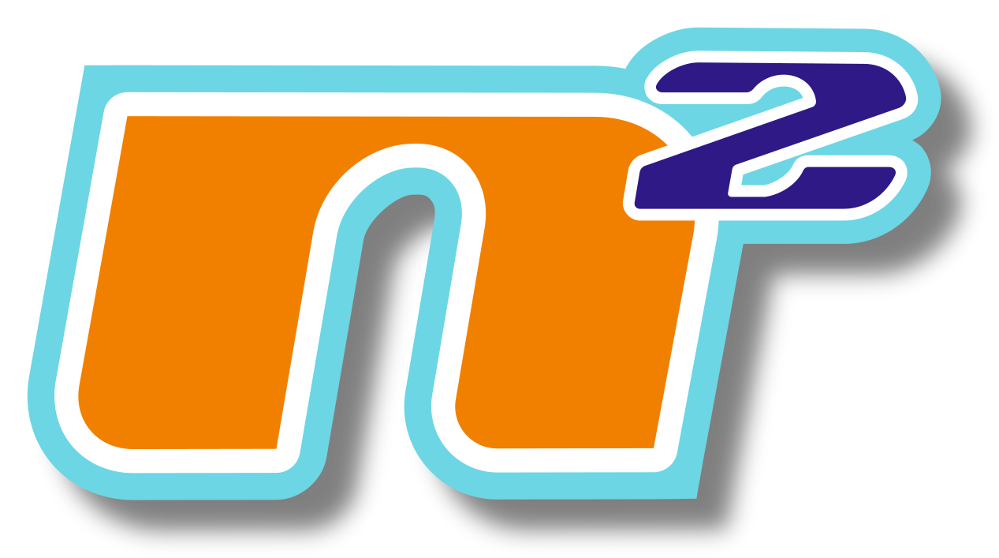
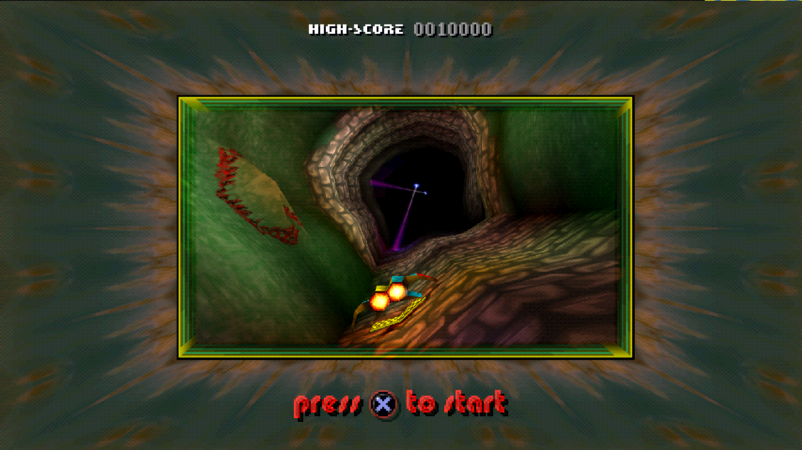
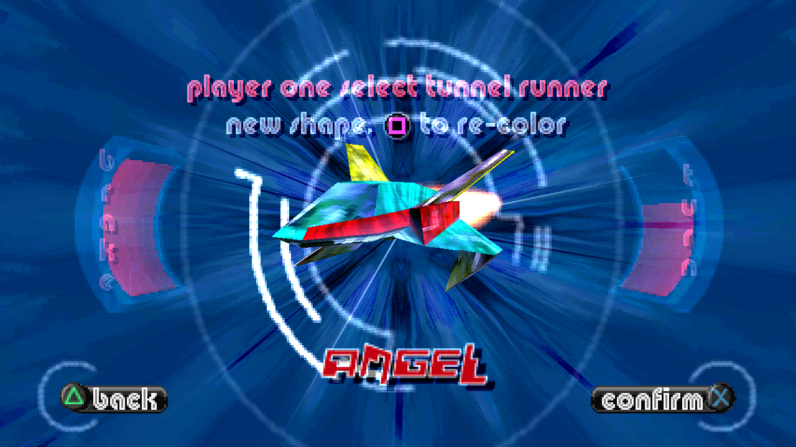
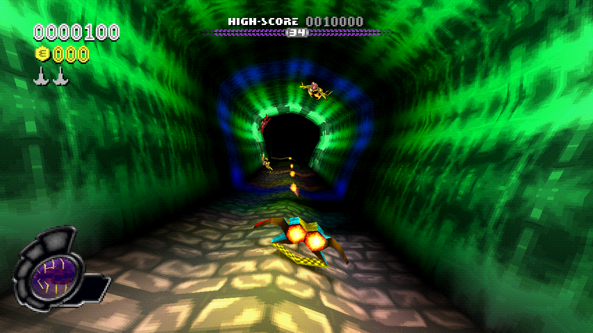
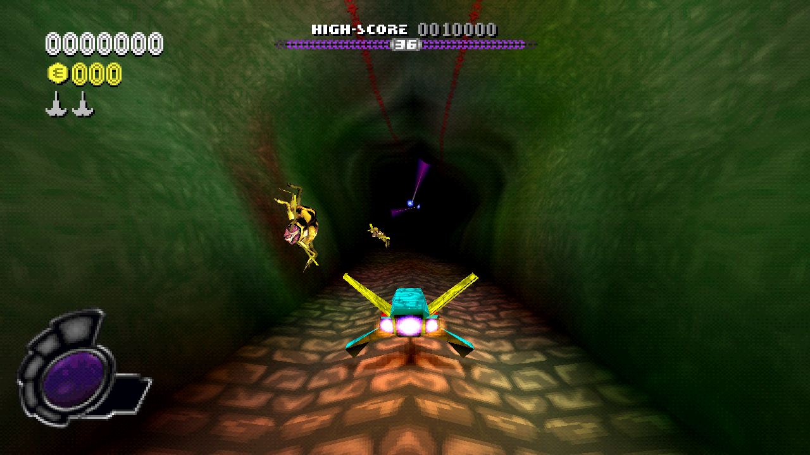

<h1 align="center">
  
</h1>

  <b>N2O: Nitrous Oxide (PlayStation), recompiled for Windows and Linux.</b>

  
  
  
  

  <a href="https://github.com/TheEelYT/Nitrogen-Squared/releases">Releases</a> ·
  <a href="#controls">Controls</a> ·
  <a href="docs/DEVELOPMENT.md">Building from source</a> ·
  <a href="docs/ROADMAP.md">Roadmap</a> ·
  <a href="THIRD_PARTY.md">Credits &amp; dependencies</a> ·
  <a href="https://github.com/TheEelYT/Nitrogen-Squared/issues">Issues</a>

> [!IMPORTANT]
> **Bring your own game.** You need the supported **USA CUE/BIN** of N2O: Nitrous
> Oxide. The launcher verifies your disc and compiles the game privately on your
> computer. Releases include no game code, game assets, music, saves or Sony BIOS.
> Keep the matching CUE and BIN together and available after setup.

## Screenshots

<table>
  <tr>
    <td width="50%"></td>
    <td width="50%"></td>
  </tr>
  <tr>
    <td width="50%"></td>
    <td width="50%"></td>
  </tr>
</table>

## Features

### Desktop presentation

- **Widescreen and window-sized rendering**, with square pixels and nearest-neighbor presentation.
- **Independent HUD and text scaling:** AUTO or 2X, 3X, 4X and 6X. AUTO keeps a 2X minimum.
- **Windowed, borderless fullscreen or fullscreen** in the in-game Video menu.
- **Render resolution from 25% to 200%** of the window size, separate from the interface.

### Sound and controls

- Native playback of all three opening movies, with audio and skip controls.
- Keyboard and SDL gamepad input, including analog controllers.
- In-game **Audio**, **Video**, **Controls** and **Extras** menus. Audio includes master, SFX, ambient and music volume.
- Hold **Back** on the **title screen** for **two seconds** to close. A fading **closing...** caption shows progress; release to cancel. On keyboard, use **Backspace** with the mapping below.

### Portable setup and saves

- The launcher verifies your disc, downloads pinned build dependencies and prepares your private game.
- **Check for updates** installs updates while preserving local files and saves.
- Downloaded tools, extracted files, builds, logs and saves stay inside the installation's `.local` folder.
- **Asset folders** optionally organizes your own textures, models, maps, sound banks, movies and CD music for inspection. Runtime still uses the disc; replacement packs and folder-backed loading are future work.

## Quick start

Get the **latest release from the [Releases tab](https://github.com/TheEelYT/Nitrogen-Squared/releases)** and choose the ZIP for your platform. Extract the complete **Nitrogen-Squared** folder somewhere writable before starting the launcher.

### Windows 10/11 x64

1. Extract `Nitrogen-Squared-Windows-x64.zip` and run **launcher.exe**.
2. Select your supported USA **CUE** file, with its matching BIN beside it. Selecting the BIN also works when its matching CUE can be found beside it.
3. Let preparation finish, then play. First setup needs internet access and can take several minutes; later launches reuse the prepared game.

No separate Python, Node.js, Rust or Visual Studio installation is required. The launcher uses Microsoft Edge WebView2, normally present on Windows 10/11. The Windows package includes portable Python and downloads its pinned preparation tools.

### Linux x86_64

1. Install Python **3.11+**, GTK 3, WebKitGTK **4.1**, Git, CMake **3.20+**, Make, a C11/C++17 compiler, pkg-config and the graphics/audio development libraries listed in the package's **README-FIRST.txt**.
2. Extract `Nitrogen-Squared-Linux-x64.zip`, open a terminal in the extracted **Nitrogen-Squared** folder and run `sh launcher.sh`.
3. Select the supported USA CUE/BIN and let preparation finish. First setup needs internet access; the launcher uses your system compiler and Python.

Linux runs the game through OpenGL. Keep Windows and Linux installations in separate folders. PS Vita is planned; no Vita package is available yet.

The Tauri launcher, adapted from [Dittobyte/Recompia](https://github.com/Dittobyte/Recompia), has **Home**, **What's New** and **Settings** pages. Settings includes window mode, HUD scale, scene resolution and master volume; these apply on the next game launch. Bundled/cached release notes remain available offline.

## Controls

### Keyboard — Digital Pad

Version 0.1.3 applies these defaults in the compiled game, including upgrades
from the original stock layout. After updating, use **Play** to rebuild.
The 0.2.1 launcher/workflow changes leave native coverage at 38.4156% linked / 61.5844% outside.
Existing custom keyboard profiles remain unchanged; `keybinds.ini` beside the
game executable stores them. The S key intentionally drives both D-pad Down
and L1 for menu navigation and braking. Gamepad bindings are unchanged.

| PlayStation input | Key |
| --- | --- |
| D-pad Up | W |
| D-pad Right | D |
| D-pad Down | S |
| D-pad Left | A |
| Cross | Enter |
| Circle | Right Shift |
| Triangle | Backspace |
| Square | E |
| Start | P |
| Select | O |
| L1 | S |
| R1 | Space |
| L2 | Minus (`-`) |
| R2 | Equals (`=`) |

### Menus

Use **WASD** to move, **Enter** to select and **Backspace** to go back.

### Gameplay

| Action | Key |
| --- | --- |
| Move left / right | A / D |
| Brake | S |
| Jump | Space |
| Fire main weapon | Enter |
| Fire secondary weapon | Right Shift |
| Switch secondary weapon | W |
| Activate firewall | E |
| Activate shield | Backspace |
| Pause / resume without a menu | P |
| Open the pause menu | O |
| Zoom out / in | Minus (`-`) / Equals (`=`) |

The in-game **Controls** screen selects the game's controller configuration.

### Desktop shortcuts

| Action | Key |
| --- | --- |
| Hide / show the System and Debug menu bar | F1 |
| Toggle fullscreen | F11 |
| Close from the title screen | Hold Backspace for 2 seconds; release to cancel |

Holding Tab does not speed up the game.

## Updating

New work and test candidates live on **dev**. Releases are published only after
the owner verifies and explicitly clears them. Test candidates are available as
GitHub Actions artifacts; see [the release process](docs/RELEASE_PROCESS.md).

Use **Check for updates** for published releases. Starting with **0.2.1**, Play rebuilds when game/runtime build inputs change and reuses your existing compatible game for launcher-only updates. The first upgrade from 0.1.x prepares once to establish this compatibility check. Opening the launcher also applies the shared-save configuration repair for direct EXE shortcuts. Keep the complete installation folder together and preserve **`.local`**; it holds your saves, settings and private build. Moving the folder may require a fresh build cache while retaining saves. Do not delete `.local` to update.

If an older launcher cannot install an update, get the latest platform ZIP from **Releases** and follow its release notes. Both ZIPs have checksums in **SHA256SUMS.txt**. GitHub provides source archives automatically.

## Saves, settings and logs

Paths below are relative to the extracted **Nitrogen-Squared** folder.

| What | Where |
| --- | --- |
| Portable saves and memory cards | `.local/saves` |
| In-game Video and Audio settings | `.local/nitrogen-options.ini` |
| Launcher state | `.local/launcher-state.json` |
| Setup log | `.local/setup.log` |
| Game startup / runtime log | `.local/runtime-dev/runtime.log` |
| Optional extracted asset folders | `.local/game` |
| Private build and caches | `.local/runtime-dev` and other folders inside `.local` |

Portable direct EXE launches and launcher play share `.local/saves` after the launcher repairs their configuration. If an older direct launch created `.local/runtime-dev/saves`, that folder is preserved; when both folders exist, cards are not merged or overwritten. Developer builds use their own save location; see [development](docs/DEVELOPMENT.md). Back up your saves before experimenting with builds or moving them between installations.

## Current status and known issues

Windows and Linux launcher packages are available. The project combines native translations and host implementations with interpreter fallback; it is still in development.

**Linked native range coverage: 38.4156%; outside linked ranges: 61.5844%.** This measures 324,928 of 845,824 executable-payload bytes, including embedded data. It is neither overall completion nor the proportion of CPU time running natively. See [native progress](docs/NATIVE_PROGRESS.md) for the breakdown and method.

- An intermittent stutter when entering a new level remains open.
- Broader Linux desktop, Wayland and audio-device compatibility still needs player testing.
- Only the verified USA disc layout is supported. Other dump layouts and EU support need separate verification; rejection does not mean your disc is bad.
- Gameplay audio and simulation/render clock separation, mod-pack loading and Vita support remain future work.

[Player checks](TESTING.md) · [Validation record](docs/VALIDATION.md) · [Roadmap](docs/ROADMAP.md)

## Reporting problems

[Open an issue](https://github.com/TheEelYT/Nitrogen-Squared/issues) with your release version, operating system, GPU, steps to reproduce and the relevant setup or runtime log. On Linux, include your distribution and whether you use X11 or Wayland.

Do not attach disc images, game executables, generated C, private build caches or saves. For disc-verification errors, include the error message and dump layout rather than uploading the disc.

## Development and credits

Build and analysis commands are in [Development](docs/DEVELOPMENT.md). Technical details live in [Disc analysis](docs/DISC_ANALYSIS.md), [Native progress](docs/NATIVE_PROGRESS.md), [Display policy](docs/WINDOW_DISPLAY.md) and [Game options](docs/GAME_OPTIONS.md).

Nitrogen Squared uses the pinned [PSXRecomp](https://github.com/RetroPortingToolKit/psxrecomp) framework, SDL3, Dear ImGui and PCSX-Redux OpenBIOS. The project's original code is licensed under [GPL-3.0-or-later](LICENSE) (see [COPYRIGHT](COPYRIGHT)); previously distributed MIT versions retain their permissions; dependencies retain their own terms, including PSXRecomp's PolyForm Noncommercial license. See [THIRD_PARTY.md](THIRD_PARTY.md) and the [distribution policy](docs/DISTRIBUTION.md).

The Nitrogen Squared logo is original artwork made by the project owner in GIMP. N2O: Nitrous Oxide and the game imagery belong to their respective rights holders. This is an independent fan project, not an official release.
